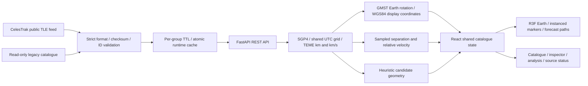

# Orbital Guardian 2.0

An independent public-TLE orbital research workspace built with React, Three.js and FastAPI. Explore a catalogue, inspect predicted trajectories, compare sampled separations and examine explicitly unvalidated manoeuvre candidates.

The original project records an **8th-place finish among 389+ teams at the IIT Hyderabad Technical Showcase (March 2026)**. This iteration preserves its SGP4/FastAPI foundation while improving data validation, scientific transparency and analytical usability.

## What is implemented

- Validated CelesTrak TLE ingestion with checksum/format checking, deduplication, bounded HTTPS requests and per-group caching.
- Explicit source, retrieval time, element epoch, snapshot time, freshness policy and propagation failures.
- Interactive Earth-fixed globe with instanced markers, shared catalogue selection, layer controls and a discrete two-hour forecast scrubber.
- Searchable, sortable and filterable catalogue; selected-object element details.
- Pair screening on a shared UTC grid with relative speed, sampled-separation plot and reproducible inputs.
- Primary-asset screening against the first 500 active-catalogue candidates, with attempted/successful/failed counts.
- Heuristic manoeuvre candidates with no fabricated confidence, fuel consumption or post-burn separation.
- Scientific reference tests, API/input regressions, frontend interaction tests and GitHub Actions configuration.

## Run locally

Use Python **3.11** (the pinned NumPy version is not intended for Python 3.13) and Node **22** with npm. Run from the repository root:

```bash
python3.11 -m venv backend/.venv
backend/.venv/bin/pip install -r backend/requirements-dev.txt
cd frontend
npm ci
cd ..
```

Terminal 1 — deterministic offline demonstration using validated bundled elements:

```bash
ORBITAL_OFFLINE=1 backend/.venv/bin/uvicorn backend.app.main:app --host 127.0.0.1 --port 8000
```

Terminal 2:

```bash
cd frontend
HOST=127.0.0.1 PORT=3000 BROWSER=none npm start
```

Open http://localhost:3000. API documentation: http://localhost:8000/docs.

For live retrieval, omit `ORBITAL_OFFLINE=1`. Optional configuration is documented in `backend/.env.example`; copy it to `backend/.env` to customize. The backend loads this file. The frontend defaults to `http://localhost:8000`; set `REACT_APP_API_URL` in `frontend/.env` before building to use another API. No credentials are needed for public CelesTrak data.

The bundled catalogue contains **June 2026 elements**; it is intentionally reported as stale at current dates. Retrieval time is unknown. Invalid legacy fallback records are rejected, not repaired or relabeled live. Freshness uses a visible seven-day heuristic, not an accuracy guarantee.

## Verify

```bash
backend/.venv/bin/python -m unittest discover -s backend/tests -v
ORBITAL_OFFLINE=1 backend/.venv/bin/python -m backend.scripts.benchmark
cd frontend
npm run lint
CI=true npm run test:ci
CI=true GENERATE_SOURCEMAP=false npm run build
```

`GENERATE_SOURCEMAP=false` avoids an existing third-party MediaPipe missing-source-map warning during CRA builds. No TypeScript/type-check command exists. See [verification evidence](docs/VERIFICATION.md) for actual results and unverified browser behavior.

## Architecture



`frontend/src/index.js` mounts `App.jsx`. `backend/app/main.py` owns the REST routes. `orbital_data.py` validates elements, `tle_fetcher.py` handles ingestion/cache, `propagator.py` computes states, `collision_detector.py` compares aligned samples, and `maneuver_engine.py` returns candidate geometry. There is no database, radar feed, trained AI model or background monitoring service.

## API compatibility and changes

Existing route names are preserved: `/health`, `/satellites`, `/propagate`, `/collision-check`, `/asset-scan`, `/maneuver-recommend`. `/catalog` adds an envelope with `objects` and `metadata`; `/satellites` retains its list shape with additive metadata fields.

- Propagation accepts an optional timezone-aware `start_time`; endpoints include the final forecast sample. Invalid TLEs return 422.
- Pair screening accepts `start_time` and `step_minutes` (default 1); selecting the same catalog object twice returns 422. Results preserve `path_a`, `path_b`, `min_distance_km`, `risk_level` and `closest_event`.
- Empty comparison results are `UNKNOWN` with null distance, never `SAFE` or infinity. Unequal/misaligned grids are rejected.
- Asset lookup uses exact NORAD matching in the validated active catalogue; arbitrary direct-by-ID CelesTrak lookup is no longer attempted. Objects outside that catalogue return 404.
- Maneuver fields `confidence_score`, `estimated_fuel_cost_percent` and `new_miss_distance_km` are retained but **null**. Candidate `risk_level` is `UNVALIDATED`. Clients must handle these deliberate correctness changes. An optional `event_time` aligns candidate geometry with the encounter sample.
- Default CORS allows only localhost frontend origins. For existing production hosting, set `CORS_ORIGINS=https://orbital-guardian-2-0-1.onrender.com` (comma-separated if adding origins). **No deployment has been performed.** Frontend and backend must be released together because the new frontend uses `/catalog`.

## Docker

```bash
cd backend
docker build -t orbital-guardian-api .
docker run --rm -p 127.0.0.1:8000:8000 -e ORBITAL_OFFLINE=1 orbital-guardian-api
```

The image now includes bundled data and excludes virtualenv/secrets/runtime cache. Runtime catalogs are written under `backend/data/runtime` locally, or `/app/data/runtime` in Docker. `ORBITAL_CACHE_DIR` can select a writable persistent directory. In-memory caches are per process; no distributed cache coordination exists. The Docker build itself remains unverified in this environment.

## Scientific limits

This is research/demo software, not operational collision avoidance. SGP4 uses WGS72 dynamics. Display geodesy uses WGS84, GMST, UTC approximating UT1 and no polar motion. The globe is Earth-fixed; forecast paths are not inertial conic orbits. Only the selected object advances when scrubbing; other markers remain at the catalogue snapshot.

One-minute separation sampling can miss encounters between samples. The API's legacy `SAFE` band means “above the sampled threshold,” not guaranteed safety. No covariance, hard-body radius, probability of collision, orbit determination, historical observations or validated maneuver optimization is available. A valid checksum does not guarantee accurate or recent orbital elements.

## Assessment and next work

- [Repository audit and baseline](docs/PROJECT_AUDIT.md)
- [Product gap analysis](docs/PRODUCT_GAP_ANALYSIS.md)
- [LeoLabs public-material alignment](docs/LEOLABS_ALIGNMENT.md)
- [Prioritized technical roadmap](docs/TECHNICAL_ROADMAP.md)
- [Verification and outstanding work](docs/VERIFICATION.md)
- [Visual assets and licenses](docs/VISUAL_ASSETS.md)
- [GitHub handoff and continuation prompt](docs/HANDOFF.md)

The project has no affiliation with LeoLabs. Its relevance is in catalog quality, scientific computation, transparent analysis and testing, not replication of proprietary sensing systems. The previous README referenced an MIT license, but no root LICENSE file is present; repository-wide licensing remains to be resolved by the owner. The included Space Grotesk font has its own OFL license.

## Verification continuation (18 October 2026)

22 backend and 6 frontend tests pass; actual desktop WebGL, mobile/tablet portions, local HTTP workflows and isolated live HTTPS stations ingestion have been exercised. Fixed mobile viewport overflow, stale request/loading state and near-future epochs being called recent. Browser acceptance remains partial; Docker daemon is unavailable, hosted CI unverified, dependency advisories and licenses unresolved. See [current evidence](docs/VERIFICATION.md) and [next-session prompt](docs/NEXT_SESSION.md). No deployment performed.

19 October: current tests/lint/build and isolated clean installs pass; production single catalogue request and outage/retry verified. Hosted CI succeeded for df13a9b only. Full release acceptance, Docker, portable backend locking, advisories and licensing remain open. See docs/VERIFICATION.md and docs/NEXT_SESSION.md.

20 October: hosted CI verified for `1346d864`; exact 1366×768 browser dimensions, zoom/layers and altitude/freshness filtering confirmed. Added favicon and active form names; 22 backend/6 frontend tests, lint/build pass. Maximum-horizon pair response measured at 7.35 MB. Blank reload recurred and recovered in a fresh tab; release acceptance remains incomplete. See [verification evidence](docs/VERIFICATION.md) and [continuation instructions](docs/NEXT_SESSION.md).
