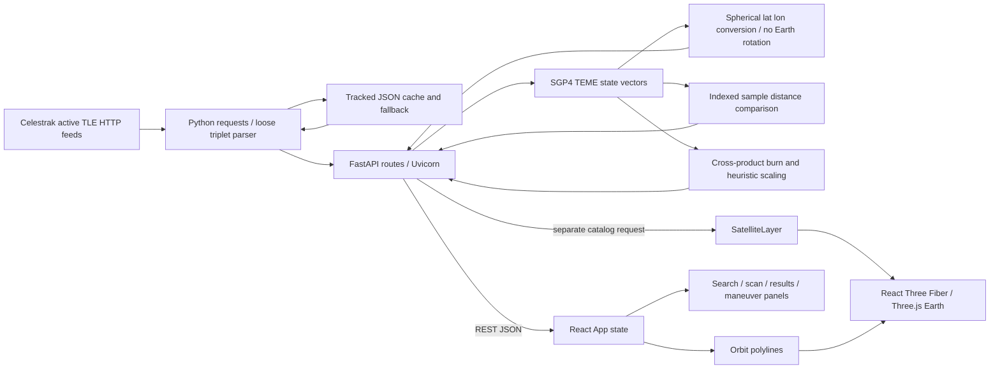

# Orbital Guardian: repository audit

Baseline: `33dd7bc`, 17 October 2026. Inspection preceded application edits. Working tree was clean; only ignored macOS metadata existed. No production changes authorized or made.

## Vision and evidence

The original starter (`888c148`) described live TLE ingestion, SGP4 forecasts, collision warnings and an “AI” avoidance advisor for satellite operators. Later commits added trajectories, asset scanning, telemetry and error guards. The current README correctly calls it a decision-support demo. Deleted notes remain accessible at `aa821e7^:hackathon_prep_guide.md` and `af2b892^:guardians-of-the-galaxy.md`: they explicitly describe a deterministic cross-product heuristic, and propose CDMs, spatial indexing, Space-Track and streaming as future work. There is no trained model, sensor ingestion, database, covariance processing or operational validation. Statements about optimal burns and precise accuracy in those notes exceed the implementation.

All tracked application modules, configuration, dependencies, data schemas, README, styles, public assets, available branches and commit history were inspected. `main` and `origin/main` are the only visible branches. No AGENTS.md, tests, CI workflow, type-check script or additional specifications were found. `CollisionAlert`, `SatelliteSelector` and `App.css` are legacy, unused by the current App. The requested `design-ui-with-restraint` and `write-practical-copy` skills were not found in available local skill catalogs; the user-provided restraint and copy principles govern the redesign.

## Baseline feature inventory

States below describe the original revision, not a claim that unexecuted UI paths passed.

| Feature | Intended behaviour | Current state | Evidence | Problem | Priority | Recommended fix |
|---|---|---|---|---|---|---|
| Catalog ingestion | Fetch requested Celestrak group | Partial | `tle_fetcher.fetch_tle_data` | All URLs hardcode active; TLS verification disabled; loose parsing | P0 | Verified HTTPS, validated group/TLEs, bounded requests |
| Offline catalogue | Resilient usable fallback | Partial | `backend/data/*.json` | Cache: 15,830 June records, no retrieval timestamp. All 51 fallback records fail checksum | P0 | Reject invalid records; label legacy cache age and unknown retrieval |
| Cache | Avoid repeated network work | Partial | Writes tracked `tle_cache.json` | No TTL; overwrites repository file; repeated fetches | P1 | Per-group TTL, atomic runtime cache separate from fixtures |
| Current positions | Show Earth-relative locations | Partial | `propagator._teme_to_geodetic` | TEME treated as ECEF, no Earth rotation, spherical latitude mislabeled geodetic | P0 | GMST rotation and WGS84 geodetic conversion, explicit EOP limitation |
| Orbit propagation | Forecast trajectories | Implemented, unvalidated | `propagate_satellite` | Separate now per object; dropped error samples; endpoint excluded | P0 | Shared UTC grid; reference vectors; explicit failures |
| Pair screening | Closest approach and severity | Partial | `calculate_closest_approach` | Index zip of misaligned times; 10-minute samples miss encounters; empty data returns SAFE/infinity | P0 | Match timestamps; unknown on missing data; reject malformed input; characterize sampling |
| Probability of collision | Quantify risk | Absent | No covariance or hard-body radius | Distance thresholds are not Pc | P2 | Explicit unavailable; defer Pc until validated covariance/CDM pipeline |
| Asset scan | Monitor object vs fleet | Partial | `/asset-scan` | First 500 only; serial work; claims entire fleet; incomplete failures hidden | P1 | Expose attempted/success/failed counts, cap and sampling limits |
| Maneuver advisor | Explain candidate burns | Partial | `maneuver_engine.py` | Arbitrary confidence, 200 m/s budget, linear miss-distance gain, unvalidated fallbacks | P0 | Keep heuristic only with assumptions; remove unsupported confidence and consequence claims |
| Threat geometry | Use conjunction direction | Broken | App sends TLE and distance only | Advisor gets default +X; zero distance replaced by 10 | P1 | Pass relative vector and event time; nullish/finite handling |
| Globe | Explore objects and paths | Partial | `Globe`, `SatelliteLayer`, `SatelliteOrbit` | Earth spins independently; duplicate catalog request; many mesh/halo draw calls | P1 | Fixed Earth frame, shared catalog, instancing, functional selection |
| Catalog search/details | Find and inspect objects | Partial | Search dropdowns | Only first ten matches; click-only divs; no catalogue table | P1 | Search/sort/filter/pagination and keyboard controls |
| Conjunction results | Understand event | Partial | `ResultsDisplayPanel` | “Collision alert” overstates threshold; null distances can crash | P1 | Honest distance bands, UTC, explicit unavailable states |
| Telemetry disclosure | Inspect vectors | Implemented, UI unverified | Results panel state toggle | Buried; limited frame/context explanation | P2 | Labeled frame and reproducible analysis parameters |
| Data provenance / health | Know freshness and availability | Mostly absent | `/health` returns static service status | No source/epoch/status UI; fake-looking pulsing indicator | P1 | Actual API check plus catalog provenance and stale warnings |
| Temporal exploration | Inspect forecast states | Absent UI | `/propagate` supplies samples | Only static paths | P2 | Discrete sample scrubber, explicit forecast labels |
| Responsive/accessibility | Operate on small screens | Partial | Fixed-height overflow and unlabelled dropdowns | Content clipping; pointer-only choices | P1 | Flow layout, semantic controls, visible focus, reduced motion |
| Tests / reproducibility | Prove calculations | Absent | unittest discovers zero; no frontend tests | No regression baseline | P0 | Reference, adversarial input, API and interaction tests; CI |
| Configuration / deployment | Repeatable local/container setup | Partial | `.env.example`, Dockerfile | Backend env unused; data omitted from image; dependency age | P1 | Load documented config, copy data, lock/test environment |
| Historical states / alerts | Persistent intelligence | Absent | No database or scheduler | Only on-demand snapshots | P2 | Versioned ingestion and persisted analysis, scoped future work |
| Space-Track / WebSockets / orbit determination | Richer inputs and realtime tracking | Planned, absent | README and deleted notes | Credentials alone implement nothing; no observations | P3 | Roadmap only, no claims in UI |

## Actual baseline architecture

TLE lines are fetched on request, minimally checked and written as arrays to a tracked JSON file. There is no update scheduler or database. Every position/velocity is computed on the server in TEME km and km/s. Current state and forecasts use wall-clock UTC independently. Collision comparisons zip arrays, use Euclidean distance, and label <10 km CRITICAL, <50 km WARNING, otherwise SAFE. These are arbitrary screening bands, not probabilistic risk. The maneuver engine computes a direction perpendicular to velocity and threat and applies distance-based delta-v rules; fuel and confidence are estimates with no spacecraft model. The client converts provided lat/lon/alt into scene coordinates and draws meshes/lines; it does not propagate physics.

Workflow: choose A/B in `CollisionMonitorPanel` → `App.handleCheckCollision` → GET `/collision-check` → two independent `propagate_satellite` calls → `calculate_closest_approach` → results panel. The App then requests two four-hour paths and, for non-SAFE results, triggers `/maneuver-recommend`. The threat direction is not derived from closest-event positions in the original App.

## Baseline verification

- Python 3.11 virtualenv installed; default system Python was 3.13. Node 22.11 / npm 10.9. Locked npm install succeeded after network sandbox retry. No tracked setup changes.
- `python -m unittest discover -s backend -v`: zero tests, exit 0 (not evidence of correctness).
- Initial CRA test invocation hit environment Watchman permissions; rerun with `--watchman=false` recorded separately.
- ESLint: zero errors, one missing-hook-dependency warning in ManeuverPanel.
- Original production build and final checks are recorded in `VERIFICATION.md`.
- TestClient: `/health` 200; malformed `bad` TLE collision request incorrectly returned 200. Empty calculation returned Python infinity and SAFE (not valid strict JSON).
- 100 cached objects × 24h, 10-minute default propagation: 0.2958 s on this host, single run, excluding network/serialization. First two grids have different timestamps. This is a baseline observation, not a benchmark distribution.
- All 15,830 cache pairs passed sgp4 checksum checking; all 51 fallback pairs failed. First cache epoch is 2026 day 170. No synthetic records were used to represent live state.
- Public frontend GET/HEAD returned 200, bundle `main.7d718107.js`; bundle references `https://orbital-guardian-2-0.onrender.com`, whose `/health` returns 200. Source and deployed service split agree. The browser tool has no DOM browser surface; native Brave capture was blank and exposed no page content. This does not prove the website is blank for users. Deployed end-to-end workflows/console remain unverified. No production mutation occurred.

## Implementation scope selected after audit

Preserve React/R3F and FastAPI/SGP4. Repair validation, time/frame correctness and error semantics; add provenance and bounded caching; build a restrained catalogue-first workspace around actual capabilities. Keep advanced Pc, orbit determination, maneuver optimization and streaming on the roadmap. Final outcomes and remaining limitations are recorded in the verification document and roadmap.

## Final checkpoint

The selected implementation is in the working tree. Final automated results: 18 backend tests, 4 frontend tests, lint and production build pass. The detailed changes, compatibility adjustments, numerical evidence and unverified browser/runtime checks are in [VERIFICATION.md](VERIFICATION.md). The baseline inventory above is intentionally retained as historical evidence; it does not describe the final implementation state.

## 18 October continuation

Browser instrumentation now supplies actual screenshots. Desktop WebGL, 390px mobile and 768px tablet checks found and repaired mobile viewport overflow. Request cancellation and future-epoch classification were hardened; 22 backend and 6 frontend tests pass. Real HTTP pair/scan and isolated live HTTPS stations ingestion succeeded. Acceptance remains partial: laptop/remaining interaction/fault-injection checks, dependency remediation, Docker, CI and licensing are outstanding. See VERIFICATION.md and NEXT_SESSION.md; earlier final-checkpoint counts are historical.

19 October evidence: current and clean-install tests/build pass, with identical frontend build files; Python certifi transitive drift observed. Production one-catalogue request and outage/retry confirmed. Hosted CI success covers df13a9b only; Docker unavailable. Browser acceptance/security/licensing remain incomplete. See VERIFICATION.md.
